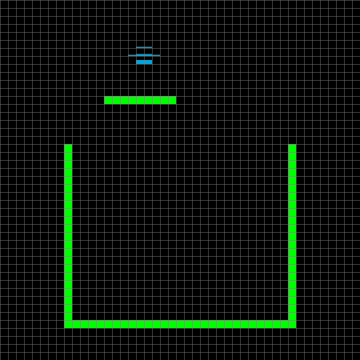

# Fluid Simulation

A 2D liquid simulator in C with SDL3, using a cellular automaton. You draw walls on a 45 x 45 grid and pour liquids in. There are 20 of them, from gasoline (0.72) to mercury (13.56), each with its relative density. Everything is in `main.c`.

The flow rules come from Jon Gallant's article [2D Liquid Simulator With Cellular Automaton in Unity](https://www.jgallant.com/2d-liquid-simulator-with-cellular-automaton-in-unity/). I added the different liquids, mixing and sinking by density on top.



Water on a shelf, then oil, then mercury going to the bottom, and `P` for the pressure view at the end. The GIF is recorded by `docs/demo.c`, which uses the same simulation and drawing code.

You need gcc, make, pkg-config and SDL3. On Fedora: `sudo dnf install gcc make SDL3-devel libasan`.

```sh
make run
make test   # runs the simulation in a closed box, no window
```

It builds with AddressSanitizer by default, `make SANITIZE=` turns it off.

Left drag paints the selected liquid, right drag erases. Space selects walls, `W` water, `M` mercury, the number row and `Q S D F G H J K L` (home row on AZERTY) the other liquids. The full list with densities is at the top of `main.c`. `P` switches to the pressure view, which shades each cell by how much liquid is above it.

Each cell is empty, a wall, or one liquid with a level (1.0 is full, a bit more when compressed). Every frame runs three passes, 5 times: the flow from the article (down, then sideways, then up for compressed liquid, which is what makes U-tubes work), then mixing, then density, where a heavier liquid swaps with a lighter one below it.

Two liquids mix when their densities are at most `MIX_THRESHOLD` apart, and with the default of 10 that's every pair except with mercury. So in practice mercury is the only one that stays separate and sinks. Levels under `MIN_FLOW` get cleared like in the article, so a little liquid disappears over time.
